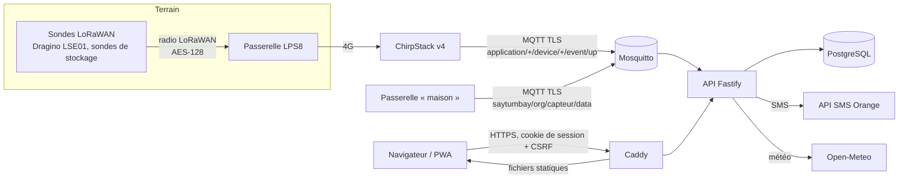

# Architecture

## Vue d'ensemble

Le site et l'API partagent le même domaine : cookies de première partie, pas de CORS.

## Un contrat, deux implémentations

`packages/shared` porte tout ce qui doit être identique partout :

- **Types** du domaine et des réponses (`domain/types.ts`, `api.ts`).
- **Validation** des entrées en zod 4 (`schemas.ts`), utilisée par les formulaires et par l'API.
- **Droits** (`domain/rbac.ts`) : rôles d'organisation (propriétaire, responsable, exploitant, technicien, lecteur) et rôles plateforme (support, admin). Le serveur décide ; l'interface masque seulement.
- **Règles métier** (`domain/rules.ts`) : état d'humidité, état d'un capteur, score de risque de stockage, textes d'alerte et de SMS.
- **Moteur** (`domain/engine.ts`) : instantanés des parcelles et des entrepôts, candidats d'alerte. Il reçoit un *fournisseur de valeurs* : dernières mesures en base pour l'API, simulateur pour la démo.

Le mode démo (`apps/web/src/demo/backend.ts`) implémente les mêmes routes que l'API, dans le navigateur. L'interface ne sait pas laquelle elle appelle (`lib/api.ts` choisit le transport). Résultat : la démo publique et la vraie plateforme racontent la même histoire avec le même code de calcul. Vérifié en faisant tourner l'interface contre l'API réelle (parcelle B à 18 %, D trop humide, E hors ligne, rangée 2 de Mboro en pourriture).

## API

- **Fastify 5**, toutes les routes sous `/api`, description OpenAPI 3.1 générée sur `/api/openapi.json` à partir des routes réelles et des schémas zod.
- **Drizzle ORM** sur PostgreSQL 17 (production) ou PGlite (développement, tests : la vraie base Postgres compilée en WebAssembly, en mémoire).
- **Stockage hybride** : comptes, sessions, jetons, mesures, alertes et journal en tables relationnelles ; agrégats métier (parcelles, capteurs, entrepôts, lots…) en « tables documents » JSONB au format exact du contrat, avec colonnes indexées `org_id` et `ref`. Toute lecture passe par `db/repo.ts`, qui exige l'organisation : un oubli de filtre est impossible par construction. Évolution prévue : passer en colonnes les champs interrogés souvent quand le volume le demandera.
- **Mesures** : table `measurements (device_id, metric, ts, value)` ; séries agrégées par `date_bin` (≤ 600 points). Au-delà de quelques millions de lignes : partitionnement par mois ou TimescaleDB, sans changer le contrat.
- **Alertes** persistées avec une clé de cause stable (`al-sol_sec-p-b`) et un index unique partiel : jamais deux alertes ouvertes pour la même cause. Ouverture, mise à jour, clôture automatique, anti-rebond de 2 h, SMS au bon destinataire (responsable de la parcelle, techniciens pour le matériel, responsables pour le stockage), selon les préférences de chacun.
- **Tâches de fond** (`services/jobs.ts`) : client MQTT, simulateur (développement), recalcul des alertes, progression des déploiements de micrologiciel, factures en retard, purge des sessions et du journal.

## Ingestion

Deux formats acceptés (`services/ingest.ts`) :

1. **SaytuMbay** : `saytumbay/{org}/{capteur}/data`, JSON validé par `telemetrySchema`. L'organisation du sujet doit être celle du capteur.
2. **ChirpStack v4** : remontée `event/up`, champ `object` décodé par le codec du profil. Le DevEUI est rattaché au capteur (`devices.ref`). Correspondance Dragino LSE01 : `water_SOIL` → humidité, `temp_SOIL` → température, `conduct_SOIL` (µS/cm) → conductivité (dS/m), `Bat` (V) → batterie (%).

Horodatage du capteur accepté s'il est plausible, sinon heure de réception. Mesures en double ignorées.

## Web

- React 19, react-router 7 (routes chargées à la demande), TanStack Query (cache, rafraîchissement 60 s), react-hook-form + zod, Radix UI, Recharts, Leaflet.
- Design system en jetons CSS (clair et sombre), polices auto-hébergées (Sora, Atkinson Hyperlegible Next), logo officiel v11 en tracés exacts.
- PWA : installable, coquille pré-cachée (~230 Ko transférés), morceaux mis en cache à la première visite, réponses de l'API en « réseau d'abord » (vidées au changement de compte).
- Premier chargement du site public : ~200 Ko compressés. Graphiques, carte et console ne se chargent qu'avec leurs pages.

## Choix écartés

- **Next.js / rendu serveur** : le site public est petit et l'espace client est une application authentifiée ; une SPA servie par Caddy reste plus simple à héberger chez Hostinger et à mettre hors ligne.
- **JWT en stockage local** : remplacé par un cookie HttpOnly opaque, révocable côté serveur.
- **Commande d'irrigation automatique côté serveur** : l'API journalise les commandes manuelles et les règles, mais n'actionne aucune vanne seule. Voir docs/A-VALIDER.md.
